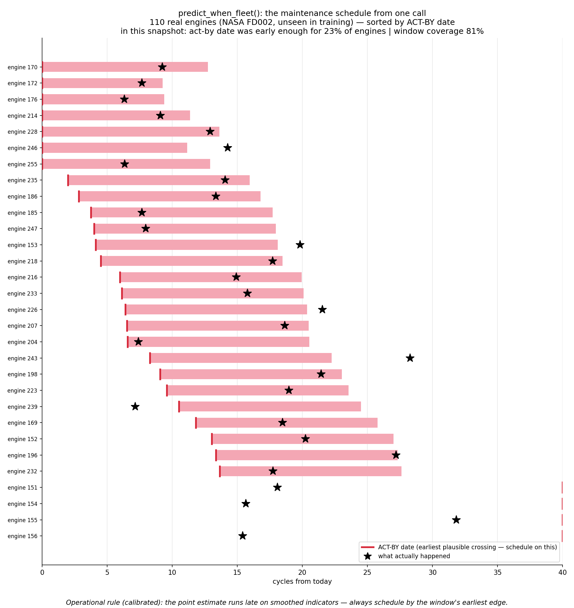
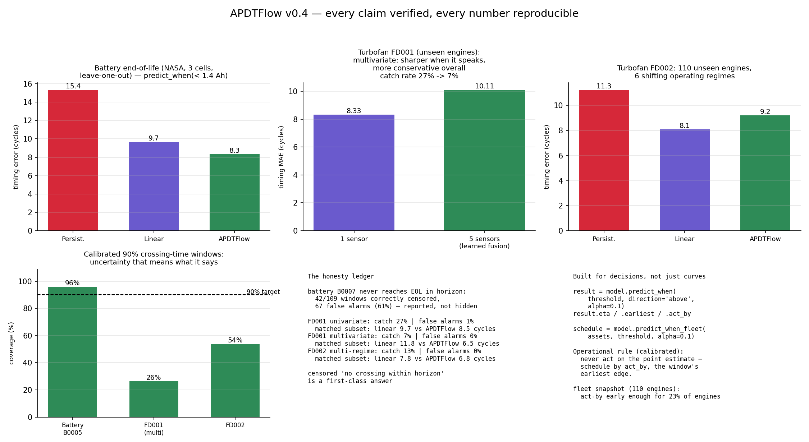
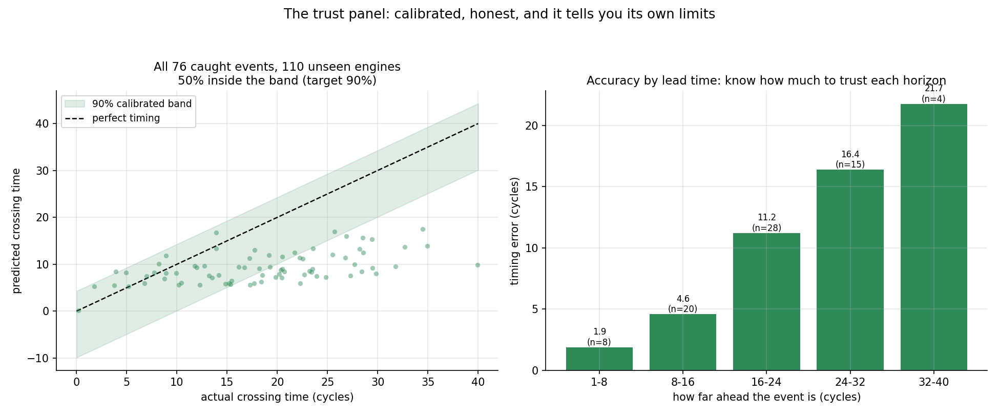
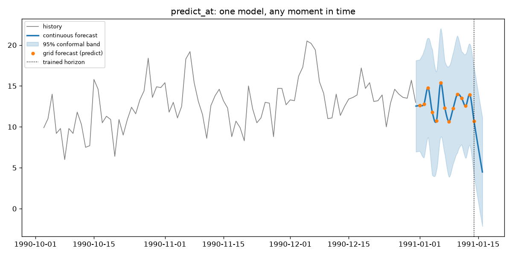
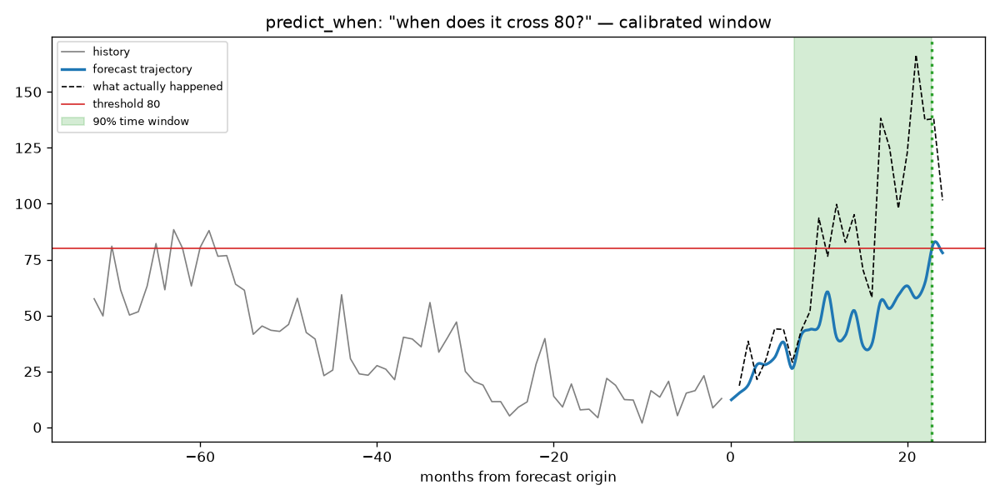

<p align="center">
  
</p>

# APDTFlow: know WHEN it will happen

[](https://pypi.org/project/apdtflow)
[](https://pypi.org/project/apdtflow/)
[](https://github.com/yotambraun/APDTFlow/actions/workflows/ci.yml)
[](https://codecov.io/gh/yotambraun/APDTFlow)
[](LICENSE)
[](https://pepy.tech/project/apdtflow)
[](https://colab.research.google.com/github/yotambraun/APDTFlow/blob/main/Quickstart.ipynb)

**[Website](https://yotambraun.github.io/APDTFlow/)** ·
**[Quickstart notebook](Quickstart.ipynb)** ·
**[Docs](docs/index.md)** ·
**[Features](docs/features.md)** ·
**[Benchmarks](docs/experiment_results.md)** ·
**[GPU & performance](docs/gpu_and_performance.md)** ·
**[Methodology](docs/METHODOLOGY.md)**

Most forecasting tools tell you *what the value will be*. Operations and reliability
teams usually need something else: **when will this metric cross the line?** APDTFlow
models time as continuous (Neural ODEs), so one trained model answers that question
directly, with a calibrated uncertainty window on the time itself and an `act_by`
date to schedule against.

| Question | API |
|---|---|
| What are the next k values? | `model.predict()` |
| What is the value at **any** moment (14:37, in 3.6 steps, beyond the trained horizon)? | `model.predict_at(timestamps)` |
| **When** will the value cross a threshold, with uncertainty on the time itself? | `model.predict_when(threshold)` |
| Which assets in a fleet need attention first? | `model.predict_when_fleet(assets, threshold)` |



*`predict_when_fleet()` turns real NASA jet engines (never seen in training) into a
maintenance schedule sorted by act-by date, with what actually happened marked. In
this measured snapshot the calibrated windows covered 81% of the actual crossings.*

## Install

```bash
pip install apdtflow
```

Python 3.10–3.14. PyTorch is installed automatically; on Linux the default wheel
already includes CUDA. On Windows, install the CUDA build of PyTorch first
([pytorch.org](https://pytorch.org/get-started/locally/)) to use an NVIDIA GPU. On
CPU-only Linux machines, `pip install torch --index-url
https://download.pytorch.org/whl/cpu` is a much smaller download. Extras:
`apdtflow[serve]`, `[mlflow]`, `[wandb]`, `[dev]`.

## Quickstart

```python
import pandas as pd
from apdtflow import APDTFlowForecaster

url = ("https://raw.githubusercontent.com/yotambraun/APDTFlow/main/"
       "dataset_examples/daily-minimum-temperatures-in-me_clean.csv")
df = pd.read_csv(url, parse_dates=["Date"])

model = APDTFlowForecaster(forecast_horizon=14, history_length=30, num_epochs=5,
                           decoder_type="continuous", use_conformal=True)
model.fit(df, target_col="Daily minimum temperatures", date_col="Date")

print(model.predict())                          # next 14 days
print(model.predict_at(["1991-01-01 14:37", 3.6]))  # any moment: timestamp or step offset
r = model.predict_when(threshold=11.0, direction="below", alpha=0.1)  # below 11 °C?
print(r.eta, r.earliest, r.latest, r.act_by, r.censored)  # schedule by act_by
```

Runs in about a minute and a half on a laptop CPU (87 s measured on an i7-12700H, download included). `decoder_type="continuous"` enables `predict_at` / `predict_when`;
`use_conformal=True` calibrates the value intervals and `predict_when`'s time window
with conformal prediction. A result with `censored=True` means "no crossing
within the horizon at this confidence", which is a valid answer, and a common one on
this series: a 14-day forecast of the daily minimum stays near its recent level. Event
timing on real degradation data, measured over many seeds, is in the next section; a
single fit is one draw.

## Measured results (scripts in `experiments/`)



| Event-timing audit (real NASA data, held-out units) | APDTFlow | Linear extrap. | Persistence |
|---|---|---|---|
| Battery end-of-life, 3 cells leave-one-battery-out (timing MAE, measured cycles; June, one seed) | **8.3** (2.8 on the typical cell) | 9.7 | 15.4 |
| Turbofan FD001, 40 unseen engines (timing MAE, cycles; 0.6% false alarms) | **8.3** | 8.7 | 11.5 |
| Turbofan FD002, 110 unseen engines, 6 operating regimes (timing MAE, cycles; 0.0% false alarms) | 9.2 | **8.1** | 11.3 |

These are single-seed runs from June 2026. In them APDTFlow beat both baselines on
the battery and FD001 audits and **lost to linear extrapolation on FD002** (while
posting zero false alarms across its 2,638 no-crossing windows). **A November re-run of the battery
audit across 10 seeds, on different hardware and PyTorch, put APDTFlow slightly behind
linear extrapolation on average** (pooled MAE 9.1–12.0, mean 10.7, vs 9.7; it won on 2
of 10 seeds), with honest censoring on every seed. Read the single-seed rows as one draw, not a ranking. FD001 and FD002 have
not been re-run across seeds yet. Time-window coverage measured 96% / 40% / 54%
against a 90% target in June (0–100% across the battery re-run seeds, mean 73%). These audits
calibrate on the training windows, the library default ([METHODOLOGY.md](docs/METHODOLOGY.md)
compares it with holding windows out). Details and per-seed tables:
[docs/experiment_results.md](docs/experiment_results.md).



**The operational rule: schedule by `act_by` (the window's earliest edge), never by
the point estimate.** The trust panel shows why. Point estimates saturate toward
mid-horizon for distant events, and the per-lead-time error bars tell you how much
to trust each horizon.

| | |
|---|---|
|  |  |
| `predict_at`: one model queried at arbitrary real-valued times, with interpolated conformal intervals (`examples/predict_at_demo.py`). | `predict_when`: "when will solar activity rise above 80?" The point estimate (month 23) is late; the 90% window (months 7–23) held the real crossing at month 10, and `act_by` (month 7) was on time (`examples/predict_when_demo.py`). |

## Is the base forecaster accurate?

MAE relative to seasonal-naive (<1.0 beats it), 12-step horizon, 6 datasets (2 real),
measured June 2026 with `experiments/benchmark_multidomain.py`:

| Dataset | APDTFlow | Linear | Holt-Winters |
|---|---|---|---|
| Daily min temperature (real) | **0.73** | 0.74 | 0.80 |
| Regime-switching nonlinear | **0.77** | 0.83 | 0.86 |
| Trend + dual seasonality | 0.85 | 0.50 | **0.38** |
| Retail-like multiplicative seasonal | 1.01 | **0.68** | 0.81 |
| Electric production (real, 397 pts) | 1.52 | **1.03** | 1.23 |
| Random walk (unpredictable) | 1.86 | 1.15 | 1.12 |

For pure grid accuracy on regular data, tuned deep models (NeuralForecast) or
zero-shot foundation models (Chronos-2, TimesFM, Moirai-2) may be stronger. APDTFlow's
value is the questions grid models do not answer: `predict_at` at arbitrary times and
calibrated `predict_when` event timing. It complements a foundation model rather than
replacing one.

## GPU and performance

`device="auto"` (the default) picks CUDA, then Apple MPS, then CPU. Every code path
runs on the selected device: training, conformal calibration, `predict`,
`predict_at`, `predict_when` and fleet scoring. Checkpoints are stored on CPU, so a
model trained on a GPU loads anywhere, and `model.to("cpu")` moves a fitted model.

On an NVIDIA GPU each training step is captured once and replayed as a **CUDA
graph**: the same arithmetic without the ~20,000 tiny kernel launches per step that
used to make the GPU slower than the CPU. Measured on one laptop (Intel i7-12700H vs
an RTX 3050 Ti Laptop GPU, WSL2), the **GPU now trains 4.4x faster than the CPU at
the default size** (1.0 vs 4.6 s per epoch) and 5–7x faster for bigger models.
Single-window calls are still faster on the CPU, so train on the GPU and serve with
`model.to("cpu")`; fleet-scale scoring favours the GPU. Full tables, the profile, the
method and the measured reason AMP is not used:
[docs/gpu_and_performance.md](docs/gpu_and_performance.md).

## When NOT to use APDTFlow

- Stock prices or crypto: random-walk regime. Nothing beats naive, including us
  (it's in the benchmark table on purpose).
- Event timing on noise-driven crossings (which exact day a noisy daily series first
  dips): no model has skill there; expect wide, honest windows.
- Irregularly sampled or heavily missing data: our ODE-RNN encoders and missingness
  features lost to simple imputation baselines ([documented](docs/METHODOLOGY.md)).
- Very short series (< ~500 points): use ETS/ARIMA.

## What's inside

- Split and adaptive **conformal prediction** on held-out windows; `predict_when`
  windows calibrated in **time space** (on crossing-time errors), with an `alpha`
  sensitivity knob
- **Multivariate** sensor fusion (`feature_cols=`) with readable `sensor_importance_`;
  per-regime normalization for multi-condition equipment
- **Fleet API**: `predict_when_fleet()` returns an act-by-sorted schedule ready for CSV
  (train on a whole fleet with `fit(df, ..., group_col="unit")`, so no window spans two units)
- Exogenous and categorical features, rolling-origin backtesting
  (`historical_forecasts`), MASE/sMAPE/CRPS/coverage metrics, `score_recent()` drift checks
- Production plumbing: `save`/`load` with scalers and calibration, TorchScript export,
  FastAPI serving example, sklearn-style `get_params`/`set_params`, `set_seed()`,
  MLflow/W&B logging hook, `py.typed`, CLI (`apdtflow train/infer --device`)
- Architectures: Neural ODE (default), Transformer, TCN

The full list with usage snippets: [docs/features.md](docs/features.md) and the
[website](https://yotambraun.github.io/APDTFlow/features/).

## Have degradation or depletion data?

`python experiments/audit_predict_when.py --csv your.csv --value-col y --threshold 80 --direction above`
benchmarks `predict_when` against persistence, linear extrapolation and seasonal
baselines on *your* data. If APDTFlow wins, open a PR and we will feature your domain
with your numbers. That is how every result above was produced, including the ideas
we tested and **rejected** ([docs/METHODOLOGY.md](docs/METHODOLOGY.md)).

## Versioning

SemVer, pre-1.0: breaking changes land only in minor releases and are flagged in the
[CHANGELOG](CHANGELOG.md). 0.5.0 changes how conformal calibration splits data
(see the changelog). Checkpoints from ≤ 0.3.x are rejected: those versions had a
defect that made predictions independent of the input data
([engineering history](docs/METHODOLOGY.md#8-engineering-history)).

## Articles

- [A Practical Approach to Time Series Forecasting with APDTFlow](https://pub.towardsai.net/a-practical-approach-to-time-series-forecasting-with-apdtflow-78e06cb51a1b) (Towards AI)
- [APDTFlow v0.3.0: From Research to Production-Ready Time Series Forecasting](https://medium.com/towards-artificial-intelligence/apdtflow-v0-3-0-from-research-to-production-ready-time-series-forecasting-0be1848e323a) (Towards AI)

*Both cover earlier versions; the API has grown since, and v0.4.0 fixed a critical
model defect. Check the [CHANGELOG](CHANGELOG.md) before following old snippets.*

## Citation

```bibtex
@software{apdtflow,
  author  = {Braun, Yotam},
  title   = {APDTFlow: continuous-time forecasting with Neural ODEs},
  url     = {https://github.com/yotambraun/APDTFlow},
  year    = {2026},
  version = {0.5.0}
}
```

## Contributing and license

See [CONTRIBUTING.md](CONTRIBUTING.md) for the dev setup, the evidence rules, and the
benchmark roadmap. MIT licensed ([LICENSE](LICENSE)).
